# KrnlSentry — eBPF Syscall Monitoring and Threat Detection for Linux

**Project report**

| | |
| --- | --- |
| **Project** | KrnlSentry — kernel-level syscall monitoring with MITRE ATT&CK–mapped threat detection |
| **Author** | Praneeth |
| **Repository** | `github.com/praneeth132006/KrnlSentry` |
| **Languages** | Go 1.25 (user space), C (eBPF / kernel space), Bash (test harness) |
| **Status** | Working end to end; unit-tested, lint-clean, CI-gated |
| **Report date** | 15 October 2026 |

> **Reading this report.** The diagrams are [Mermaid](https://mermaid.js.org/)
> and render natively on GitHub, in VS Code (with the built-in Markdown
> preview), and in any Markdown viewer with Mermaid support. For a PDF, open the
> file on GitHub and print to PDF, or run
> `pandoc REPORT.md -o REPORT.pdf --from gfm` with a Mermaid filter. Every
> diagram in this file has been validated against the Mermaid parser.

---

## Table of contents

1. [Abstract](#1-abstract)
2. [Problem statement and objectives](#2-problem-statement-and-objectives)
3. [Background and literature](#3-background-and-literature)
4. [System architecture](#4-system-architecture)
5. [Design decisions and their justification](#5-design-decisions-and-their-justification)
6. [Detection engine](#6-detection-engine)
7. [Attack-storyline correlation](#7-attack-storyline-correlation)
8. [Noise control: deduplication and scope](#8-noise-control-deduplication-and-scope)
9. [Replay and retro-hunting](#9-replay-and-retro-hunting)
10. [Observability: the live dashboard](#10-observability-the-live-dashboard)
11. [Output contract](#11-output-contract)
12. [Testing and verification strategy](#12-testing-and-verification-strategy)
13. [Results](#13-results)
14. [Limitations](#14-limitations)
15. [Future work](#15-future-work)
16. [Conclusion](#16-conclusion)
17. [References](#17-references)
18. [Appendix A — Repository layout](#appendix-a--repository-layout)
19. [Appendix B — Command reference](#appendix-b--command-reference)

---

## 1. Abstract

KrnlSentry is a host-based threat detection agent for Linux. It attaches eBPF
programs to 15 syscall tracepoints, streams the observations into user space
over a shared ring buffer, and evaluates them against four behavioural detection
rules covering privilege escalation, credential theft, process injection and
reverse shells. Every alert is tagged with its MITRE ATT&CK technique and
emitted both as colour-coded terminal output and as append-only JSON Lines
suitable for SIEM ingestion.

Above the per-syscall rules sits an **attack-storyline correlator**. It
reconstructs process lineage from the whole event stream, bounds each story at
its session owner (`sshd`, `systemd`, `cron`, a container shim, PID 1), rolls
every alert up to its ATT&CK *tactic*, and raises a single CRITICAL
`attack-chain` incident — carrying the ordered story — when one process tree
spans three or more distinct attacker goals. This converts what would be four
unrelated-looking queue items into one intrusion with a timeline.

Two engineering properties are central to the result. First, **the detection
logic contains no eBPF**: rules are pure functions over a plain `events.Event`
struct, so the entire detection surface is unit-testable with struct literals on
any operating system, without a kernel, root, or a privileged CI runner. Second,
every capture can be **replayed offline** through the identical filter, engine
and sinks, which makes rule development, regression testing, retro-hunting and
false-positive reproduction possible without privileged access.

Measured outcome: 88 automated tests pass under the Go race detector in about
three seconds; `detect/` — where all detection logic lives — is at 94.8%
statement coverage; four live scenario scripts confirm every rule fires against
a real kernel; and a golden capture pins the exact alerts, folds and chains the
correlator must produce.

---

## 2. Problem statement and objectives

### 2.1 Problem

An attacker who has obtained code execution on a Linux host performs a
recognisable sequence of actions: read credentials, escalate privilege, inject
into or manipulate other processes, and establish an outbound channel. Each of
these is expressed in **syscalls**, and each individual syscall is, by itself,
indistinguishable from ordinary activity:

- `openat("/home/dev/.aws/credentials")` — or a developer running `cat`.
- `setuid(0)` — or `sudo` behaving normally.
- `ptrace(PTRACE_ATTACH, …)` — or `gdb` on a crash.
- `socket` → `connect` → `dup2` → `execve` — or an HTTP client plus a shell
  redirection.

So the detection problem has two parts that are usually conflated:

1. **Observation.** Getting a complete, ordered, low-overhead view of syscalls
   without the traced process being able to evade or detect the observer.
2. **Interpretation.** Deciding which *patterns* across those observations
   constitute an attack — including patterns that span multiple processes, which
   no single-syscall rule can see.

### 2.2 Objectives

| # | Objective | Where it is addressed |
| - | --------- | --------------------- |
| O1 | Observe security-relevant syscalls in-kernel, with no per-event context switch and no opt-out for the traced process | §4.1, §5 |
| O2 | Produce a single portable binary that runs on any 5.8+ kernel with BTF, with nothing installed on the target | §5 (CO-RE) |
| O3 | Detect privilege escalation, credential access, process injection and reverse shells, each mapped to MITRE ATT&CK | §6 |
| O4 | Detect a *sequence* attack (reverse shell) whose individual syscalls are benign | §6.2 |
| O5 | Correlate alerts across a process tree into one incident with an ordered story | §7 |
| O6 | Keep the detection surface fully unit-testable without a kernel or root | §5, §12 |
| O7 | Emit machine-readable output that is valid at every instant | §11 |
| O8 | Control noise so that volume cannot drown signal | §8 |
| O9 | Support offline replay for rule development, regression testing and retro-hunting | §9 |
| O10 | Give an operator standing situational awareness, not only a scrolling log | §10 |
| O11 | State the system's own limits precisely | §14 |

### 2.3 Non-objectives

Explicitly out of scope: file-integrity monitoring, network packet inspection,
response or blocking actions (KrnlSentry observes; it does not kill or deny),
and multi-host aggregation. These are the responsibility of adjacent tools, and
claiming them would make the single-host detection quality harder to assess.

---

## 3. Background and literature

### 3.1 Why not the conventional options

| Approach | Mechanism | Why it is unsuitable here |
| -------- | --------- | ------------------------- |
| `ptrace` | Stops the tracee on each syscall, user-space tracer inspects it | Halts the target (large overhead), and is trivially detectable by the tracee (`PTRACE_TRACEME` fails, `/proc/self/status` shows `TracerPid`) |
| `auditd` | Kernel audit subsystem with user-space daemon | A firehose; rule language is rigid and cannot express a sequence across syscalls within a process |
| `LD_PRELOAD` interposition | Shim libc functions | Bypassed entirely by a static binary or a raw `syscall()` |
| strace-style sampling | Periodic `/proc` scraping | Misses short-lived processes; no ordering guarantees |
| **eBPF** | Verified program runs in kernel at the syscall boundary | Filtering happens in-kernel with no per-event context switch, and the traced process cannot opt out |

### 3.2 eBPF toolchain choice: libbpf + CO-RE versus BCC

BCC compiles its kernel programs **at runtime**, which means every deployment
target needs clang, LLVM and kernel headers matching the running kernel.
CO-RE (Compile Once – Run Everywhere) compiles the BPF object once, embeds BTF
relocation information, and lets libbpf patch struct field offsets against the
*running* kernel's own type information at load time.

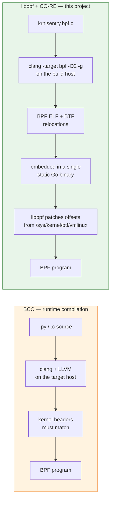

The practical consequence is objective **O2**: one static file, no runtime
dependency on clang, libbpf or kernel headers.

### 3.3 MITRE ATT&CK as the classification vocabulary

Alerts are tagged with ATT&CK technique IDs, using sub-techniques wherever one
applies, because `T1003.008` ("/etc/passwd and /etc/shadow") names the observed
behaviour, whereas the parent `T1003` names only a category. Each alert carries
both the ID and the human-readable name, so it can be triaged on sight and
grouped by a SIEM without an enrichment step.

The correlator (§7) operates one level up, on **tactics** — the attacker's goal
rather than the method — because tactic diversity is what distinguishes an
intrusion from loud-but-singular activity.

---

## 4. System architecture

### 4.1 Layered view

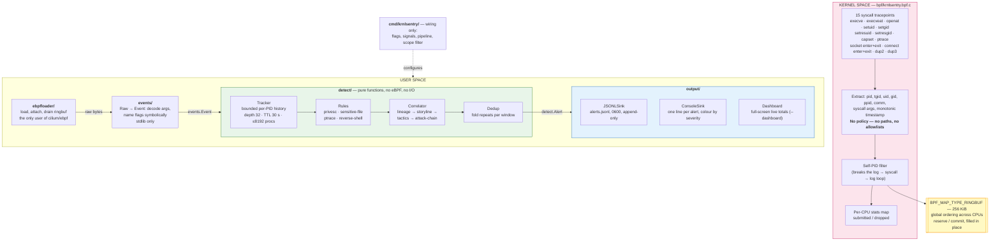

### 4.2 Package dependency graph

The single most important structural property is that **`detect/` does not
import anything but `events/` and the standard library.** That is what makes
objective O6 achievable.

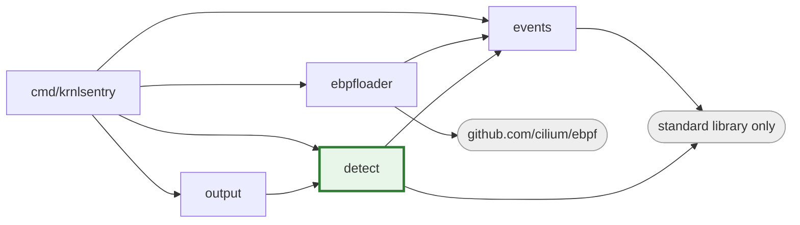

| Path | Responsibility | Depends on |
| ---- | -------------- | ---------- |
| `bpf/` | eBPF C programs, shared event struct, minimal CO-RE header | — |
| `ebpfloader/` | Loading, attaching, ring-buffer draining. **Only** user of cilium/ebpf | `events` |
| `events/` | Canonical `Event` type, argument decoding, capture record format | stdlib |
| `detect/` | Rule registry, process tracker, four rules, correlator, dedup | `events` |
| `output/` | JSONL, console and dashboard sinks | `detect` |
| `cmd/krnlsentry/` | CLI, signal handling, pipeline wiring, replay pacing | all of the above |

### 4.3 Event lifecycle

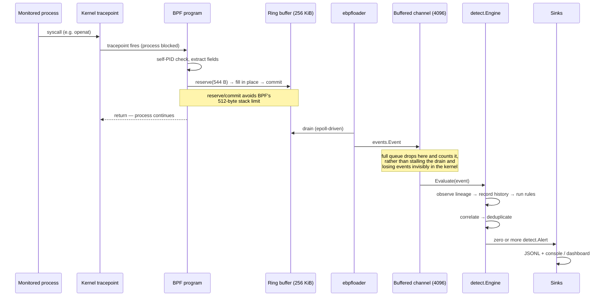

---

## 5. Design decisions and their justification

Each of the following was a genuine fork in the design, and each is defensible
on a specific technical ground rather than on preference.

### D1 — Ring buffer, not perf buffer

`BPF_MAP_TYPE_RINGBUF` (kernel 5.8+) delivers events in **global order** across
CPUs; a per-CPU `BPF_MAP_TYPE_PERF_EVENT_ARRAY` does not. The reverse-shell rule
is a *sequence* detector, so out-of-order delivery would make it **silently
wrong** rather than merely untidy — the worst failure mode available to a
detection system. The reserve/commit API also lets the kernel program fill the
event in place, which is necessary because the 544-byte event does not fit in
BPF's 512-byte stack limit.

This is also the reason the project requires kernel 5.8 or newer.

### D2 — Tracepoints, not kprobes

Syscall tracepoints are a stable kernel ABI. kprobes on `sys_*` symbols break
across kernel versions and differ between architectures
(`__x64_sys_openat` vs `__arm64_sys_openat`).

### D3 — No policy in the kernel

Everything in the BPF program runs in the syscall hot path with the calling
process blocked, under a verifier that forbids unbounded loops. String matching
and rule evaluation fit that environment badly.

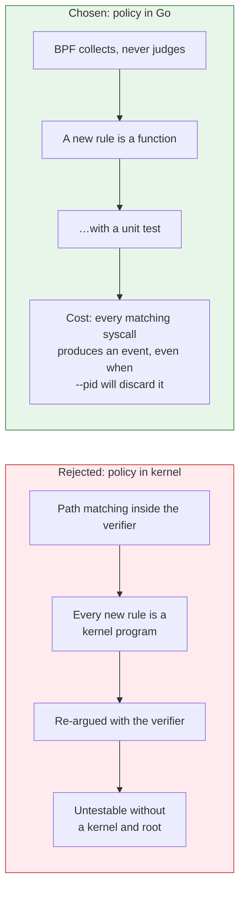

The cost in G4 is real, is stated in the README's Limitations section, and is
roadmap item 1 — not hidden.

### D4 — A hand-written minimal `vmlinux.h`

`bpf/vmlinux_min.h` declares only the ~4 kernel types this project touches,
rather than vendoring the 3.5 MB generated header. This is still full CO-RE:
`__attribute__((preserve_access_index))` makes libbpf resolve field offsets from
the running kernel's BTF at load time. The benefit is that **building needs no
BTF on the build host**, which is what makes the project buildable in a
container on a Mac.

### D5 — Monotonic time for rules, wall-clock for humans

Rules measure elapsed time with `bpf_ktime_get_ns()` (CLOCK_MONOTONIC);
`Event.Wall` is derived once at startup for logs. Using a wall clock inside the
reverse-shell window would be a real bug: an NTP step backwards makes a
2-second window briefly infinite, and a step forwards silently expires a chain
that was about to match.

### D6 — JSONL, not a JSON array

A JSON Lines file is valid at every instant. A tool killed with `SIGKILL` leaves
a complete file minus at most one line; an array without its closing bracket is
unparseable. It also streams (`tail -f | jq`).

### D7 — Generated bindings are not committed

`ebpfloader/krnlsentry_*_bpfel.go` embeds a compiled BPF ELF. A stale committed
copy would be invisible in code review and would silently ship yesterday's
kernel code, so `make build` regenerates them and `.gitignore` excludes them.

### D8 — `-O2` is mandatory, not an optimisation preference

The verifier rejects the unoptimised output clang emits at `-O0`.

### D9 — Severity reflects confidence × impact, not syscall danger

`sensitive-file-access` on `/proc/<pid>/maps` is MEDIUM while `/etc/shadow` is
HIGH, and a *completed* reverse-shell chain is CRITICAL. The scale exists to
order a triage queue, so it has to encode how certain the finding is as well as
how bad it would be.

---

## 6. Detection engine

### 6.1 Rule registry

| Rule | Trigger | ATT&CK | Severity |
| ---- | ------- | ------ | -------- |
| `privilege-escalation` | `setuid(0)`, `setresuid(0,…)`, `setgid(0)`, `setresgid(0,…)`, `capset()` from a non-root process | T1548 | HIGH |
| | `execve()` of a setuid/setgid binary by a non-root user | T1548.001 | HIGH |
| `sensitive-file-access` | `openat()` of `/etc/shadow`, `/etc/gshadow` (+ `-` backups) | T1003.008 | HIGH |
| | `openat()` of `/proc/<pid>/mem` | T1003.007 | HIGH |
| | `openat()` of `/proc/<pid>/maps` | T1003.007 | MEDIUM |
| | `openat()` of `/etc/sudoers`, `/etc/sudoers.d/*` | T1552 | MEDIUM |
| | `openat()` of `~/.ssh/id_*`, `~/.gnupg/` secret keys | T1552.004 | MEDIUM |
| | `openat()` of `~/.aws/credentials`, `~/.docker/config.json`, `~/.kube/config` | T1552.001 | MEDIUM |
| `process-injection` | `ptrace()` with `ATTACH`, `SEIZE`, `POKETEXT`, `POKEDATA`, `POKEUSER`, `SETREGS`, `SETREGSET`, `SETFPREGS` from a non-allowlisted process | T1055.008 | HIGH |
| `reverse-shell` | `socket` → `connect` → `dup2`/`dup3` onto ≥2 standard fds → `execve`, in one PID within a 2 s window | T1059 | CRITICAL |
| `attack-chain` | ≥3 distinct ATT&CK tactics across one process tree | (all) | CRITICAL |

A design detail worth noting: **a failed syscall alerts exactly like a
successful one**, because the tracepoints are on syscall *entry*. A
`setuid(0)` that returns `EPERM` is a privilege-escalation *attempt*, which is
a security event. It is also what makes the test scenarios safe by
construction — they make syscalls that are expected to be denied.

### 6.2 The interesting rule: reverse-shell as a sequence detector

None of `socket()`, `connect()`, `dup2()` or `execve()` is suspicious. The
detection is entirely about **ordering within one process in a short window**.

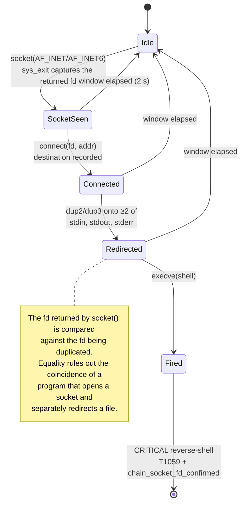

The confirmation is reported as `chain_socket_fd_confirmed` on the alert, and it
is the reason a `sys_exit_socket` probe exists at all: on syscall *exit* the
argument registers have been clobbered, so only the return value carries
meaning — which is exactly the fd needed.

### 6.3 Bounded process state

The `Tracker` keeps a per-PID history so a sequence rule can see a process's
recent syscalls. It is bounded on three axes, because an unbounded cache in a
security agent is a denial-of-service primitive:

| Bound | Value | Reason |
| ----- | ----- | ------ |
| History depth | 32 entries per process | The longest rule window needs far fewer |
| Entry TTL | 30 s | The longest rule window is 2 s |
| Process cap | 8192 processes | Worst case a few tens of MB; sweeps on a 5 s interval |

### 6.4 Evaluation order inside the engine

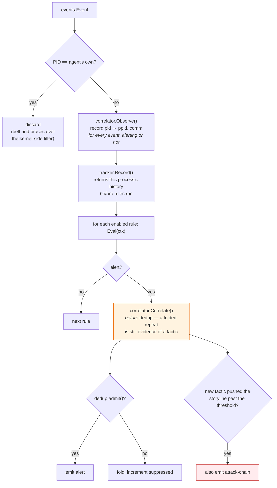

Two ordering decisions in that diagram are load-bearing:

- **The tracker is updated before rules run**, so a rule inspecting history sees
  the current event as the most recent entry. The reverse-shell rule fires on
  the `execve` that completes the chain and needs that `execve` present.
- **Correlation happens before deduplication**, because a folded duplicate is
  still evidence that a tactic occurred, and the storyline must count it even
  though the operator is not shown it again.

---

## 7. Attack-storyline correlation

### 7.1 The problem the correlator solves

Every rule in §6 judges one process at one moment. Intrusions do not look like
that. They look like a login shell whose children, one after another, read AWS
credentials, `ptrace` the shell, call `setuid(0)` and dial out — four alerts,
four PIDs, four rules, arriving in a queue as four unrelated items.

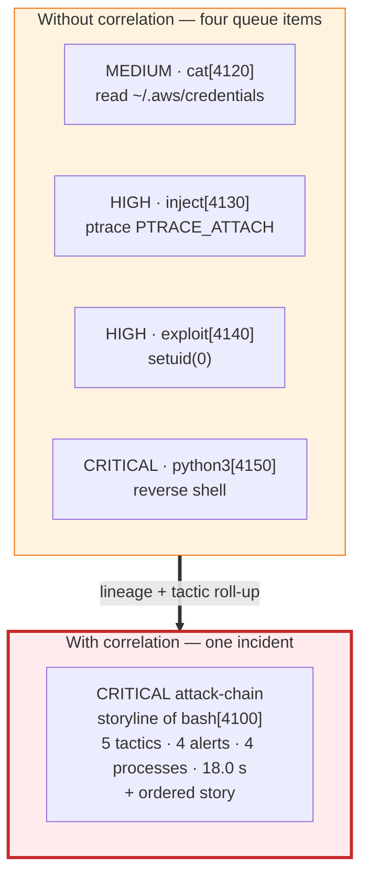

### 7.2 Reconstructing lineage

Lineage is built from the **whole** event stream, not only from alerting events.
The shell *between* two alerting children is usually the one process that never
alerts, so it would be invisible otherwise. Gaps — an ancestor that has not made
a monitored syscall since the agent started — are filled from `/proc`.

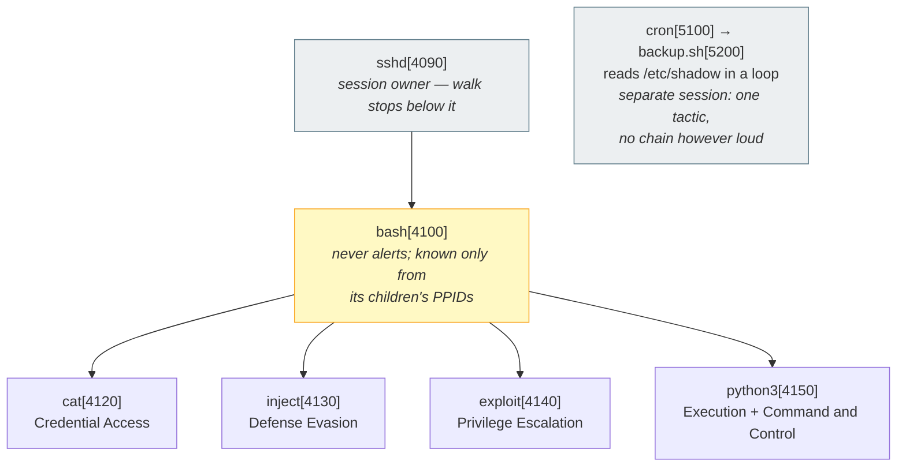

**Session boundaries** are what stop the entire host becoming one story. From an
alerting process the correlator walks up the tree and halts *below* the process
that owns the session — `sshd`, `systemd`, `containerd-shim`, `cron`, `tmux`,
PID 1. Without this, every process shares `init` as an ancestor; with it, each
SSH login, container and daemon is its own scope.

### 7.3 Storyline lifecycle

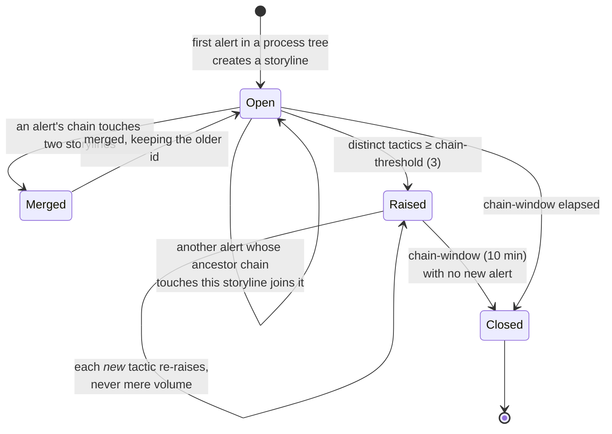

Every alert carries a `storyline` field, so a SIEM can pivot from any one alert
to everything related with a single equality filter. Stories are capped at 24
steps so one noisy tree cannot grow without bound.

### 7.4 Technique → tactic roll-up

Escalation is decided on **tactic diversity, not alert volume**.

| Technique observed | Tactic(s) credited |
| ------------------ | ------------------ |
| T1003.008, T1003.007, T1552.001, T1552.004 | Credential Access (TA0006) |
| T1548, T1548.001, T1068 | Privilege Escalation (TA0004) |
| T1055.008 | Defense Evasion (TA0005) |
| T1059 | Execution (TA0002) **and** Command and Control (TA0011) |
| T1071 | Command and Control (TA0011) |

A completed reverse shell counts as two tactics because it genuinely achieves
two attacker goals. The rationale for the whole mechanism: a process reading
`/etc/shadow` fifty times is **one** tactic, however loud; three different
attacker goals in one tree within minutes is the shape of an intrusion and
almost never the shape of administration.

### 7.5 Output: the story

An `attack-chain` alert carries an ordered `story` array — one step per
contributing alert, with `offset_ms`, `pid`, `comm`, `rule`, `mitre_id`,
`tactic` and `summary`:

```
11:00:33.731  CRITICAL attack-chain   python3[4150]   uid=1000  T1552.001,T1055.008,T1548,T1059
              Multi-stage attack in the process tree of bash[4100]: Credential Access → Defense
              Evasion → Privilege Escalation → Execution → Command and Control
              (5 tactics, 4 alerts, 4 processes, 18.041s)
              ├─ +0ms      cat[4120]       Credential Access                openat /home/dev/.aws/credentials
              ├─ +6002ms   inject[4130]    Defense Evasion                  ptrace PTRACE_ATTACH → pid 4100
              ├─ +11005ms  exploit[4140]   Privilege Escalation             setuid(0)
              └─ +18041ms  python3[4150]   Execution + Command and Control  reverse shell to 10.13.37.9:4444
```

---

## 8. Noise control: deduplication and scope

A detection tool that cannot be quietened is a detection tool that gets muted.
Three independent mechanisms address this, at different layers:

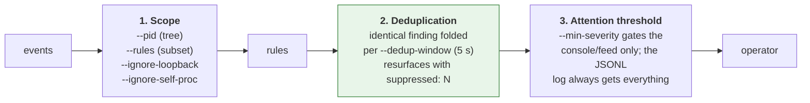

Design details that matter:

- **Identity for folding** is (rule, process, technique, distinguishing argument
  — path / ptrace target / destination). Anything else would fold two genuinely
  different findings together.
- **The window is fixed from the first emission, not sliding**, so a steady loop
  still resurfaces once per window instead of being suppressed forever.
- **Folded alerts still count as evidence** for the correlator (§6.4).
- **`--min-severity` never reduces the totals** shown on the dashboard or
  written to JSONL. It controls what competes for attention, not what is known.

Measured effect on the bundled capture: 18 raw rule hits are reported as 7
alerts plus 11 folds.

---

## 9. Replay and retro-hunting

`--verbose` writes every observed syscall to a lossless JSONL capture;
`--replay` feeds a capture back through **exactly** the same scope filter,
engine and sinks.

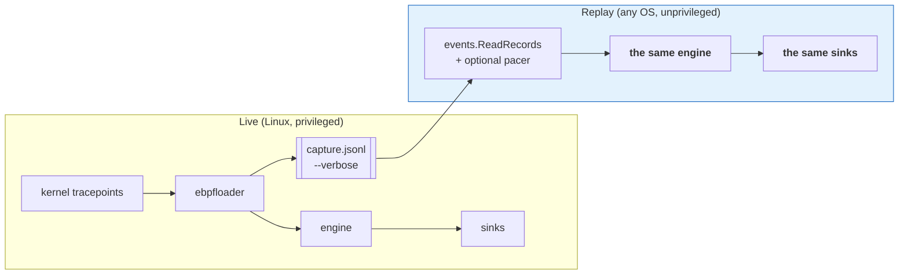

The capture format (`events.Record`) deliberately carries **two layers**: a
decoded layer (timestamp, syscall name, symbolic args) for humans reading the
file, and a typed layer (`arg0..arg2`, `path`, `argv`, `dest_ip`, `dest_port`,
`family`) which is what rules actually compute on. Without the typed layer,
replay would have to re-parse a rule's input out of a presentation string, and
would not be lossless.

This yields three capabilities live tracing cannot provide:

1. **Rule development without eBPF.** The agent builds natively on macOS and
   Windows (the loader is replaced by a stub off Linux), so a new rule can be
   written and exercised against real captures on a laptop.
2. **Retro-hunting.** Run a rule written today over last week's capture.
3. **False-positive reproduction** from the reporter's capture rather than from
   their description of it.

`--replay-speed` paces a replay against the capture's own monotonic clock
(`1` = real time). Replayed at full speed a 34-second intrusion lands in a
single frame; paced, the storyline can be watched assembling itself. Idle gaps
are capped at 2 s so a quiet capture cannot be mistaken for a hung process, and
the sleep is interruptible so Ctrl+C flushes the log and restores the terminal.

`testdata/captures/intrusion.jsonl` is a **golden capture** — an SSH session
carrying the intrusion above, interleaved with ordinary activity and a cron job
reading `/etc/shadow` in a loop — and `TestReplayGoldenCapture` pins exactly
which alerts, folds and attack chains it must produce.

---

## 10. Observability: the live dashboard

### 10.1 Why both a stream and a dashboard

The default output is one line per alert on stdout, which pipes, greps,
redirects, and reads fine over SSH. A full-screen display owns the terminal and
becomes garbage the moment anyone redirects it — which is the first thing people
do with a monitoring tool. So the dashboard is **opt-in** (`--dashboard`), and
it refuses to start when stdout is not a terminal, warning and falling back to
the stream rather than writing escape sequences into a log file. (`--color`
forces it, which is what recording a demo needs.)

What it provides that a stream cannot is **standing totals**. Mid-incident the
question is rarely "what was the last alert"; it is how many, how bad, which
rules, which processes, is a chain forming, and *are we dropping events*. On a
busy host all of that scrolls off the top within seconds.

### 10.2 Layout

```
╭─ KrnlSentry v0.4.0 · LIVE · system-wide ──────────────────── 00:04:12 ╮
   events 182 417   alerts 7   folded 11   tracked 94   drops 0
╰───────────────────────────────────────────────────────────────────────╯

  SEVERITY ───────────────────────  RULES ──────────────────────────────
  CRITICAL ███████████████████ 3     privilege-escalation          1
  HIGH     ███████████████████ 3     sensitive-file-access         2
  MEDIUM   ██████              1     process-injection             1
  LOW                          0     reverse-shell                 1
                                     attack-chain                  2

  ATT&CK TACTICS ──────────────────────────────────────────────────────
   ● Execution  ● Privilege Escalation  ● Defense Evasion
   ● Credential Access  ● Command and Control

  TOP PROCESSES ───────────────────────────────────────────────────────
   exploit[4140] ×2   python3[4150] ×2   cat[4120] ×1   inject[4130] ×1

  ATTACK CHAIN   open storylines 2   chains raised 2 ──────────────────
    CRITICAL  Multi-stage attack in the process tree of bash[4100]: …
   ├─ +0ms      cat[4120]      Credential Access     openat …/credentials
   ├─ +6002ms   inject[4130]   Defense Evasion       ptrace → pid 4100
   ├─ +11005ms  exploit[4140]  Privilege Escalation  setuid(0)
   └─ +18041ms  python3[4150]  Execution + C2        reverse shell …

  RECENT ALERTS   7 total ─────────────────────────────────────────────
   11:00:33.731  CRITICAL  attack-chain       python3[4150]  T1552.001…
   11:00:33.731  CRITICAL  reverse-shell      python3[4150]  T1059   …

╰─ alerts → /var/log/krnlsentry.jsonl ──────────────── Ctrl+C to stop ╯
```

### 10.3 Four decisions inside the display

| Decision | Reason |
| -------- | ------ |
| **Zero rows are kept** (`CRITICAL 0`, `reverse-shell 0`) | An absent row cannot distinguish "armed and quiet" from "not running" |
| **Kernel and queue drops are summed into one always-visible figure, highlighted when non-zero** | A tool that silently discarded events looks exactly like one that saw nothing suspicious |
| **`--min-severity` filters the feed, never the totals** | The operator quietens attention, not knowledge |
| **The last frame is left on screen at shutdown** | The run's totals remain readable above the summary; an alternate-screen TUI would erase precisely what the operator wants |

### 10.4 Correctness concerns a repainting display introduces

A full-screen repaint has two failure modes that unit tests now pin:

- **Column alignment.** Padding must count *printable* columns, not bytes. An
  ANSI CSI sequence is `ESC [` … final byte in `0x40–0x7E`; treating the first
  byte in that range as the terminator counts the `[` itself as the end, which
  made every styled cell measure several columns too wide and skewed the layout.
  `TestDashboardLinesFitWidth` asserts no rendered line exceeds the terminal
  width, with colour both on and off, at widths 80/110/160.
- **Frame height.** A frame one line too tall scrolls the terminal, which moves
  the cursor-home position the next repaint draws from — the display then tears
  itself apart within a second. The renderer therefore *measures* its own output
  and sheds elastic content until it fits: feed rows first, then chain steps,
  then the two context panels; never the totals.

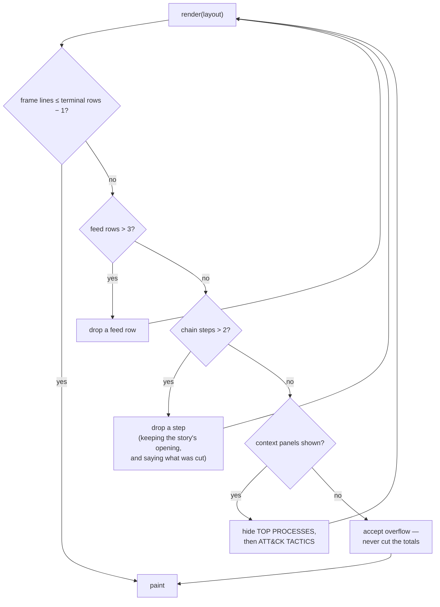

Concurrency is handled by taking the metrics snapshot **on the pipeline's own
goroutine** and having the painter read the copy under a mutex. Engine stats and
the tracker are walked by rule evaluation, so reading them from the painting
goroutine would be a data race; the split is asserted by a test that runs under
`-race`.

---

## 11. Output contract

One JSON object per line, append-only, mode `0600`.

```json
{"timestamp":"2026-08-17T10:22:31.854Z","pid":4821,"tid":4821,"ppid":4802,"comm":"bash","uid":1000,"syscall":"setuid","args":{"target_uid":"0"},"mitre_id":"T1548","mitre_technique":"Abuse Elevation Control Mechanism","severity":"HIGH","description":"Process \"bash\" (PID 4821, UID 1000) called setuid(0) — possible privilege escalation attempt","rule":"privilege-escalation","storyline":"s-1"}
```

| Field | Notes |
| ----- | ----- |
| `timestamp` | RFC 3339, wall clock. Rules measure elapsed time with the kernel's monotonic clock instead |
| `pid` | The **process** id (kernel `tgid`) — what `ps` shows |
| `tid` | The **thread** id (kernel `pid`) |
| `args` | Decoded, syscall-specific; flags symbolic (`O_RDONLY\|O_CLOEXEC`), not numeric |
| `mitre_id` / `mitre_technique` | ID plus human-readable name, so no enrichment step is needed |
| `severity` | `LOW` / `MEDIUM` / `HIGH` / `CRITICAL` |
| `rule` | Which rule fired — stable, safe to build filters on |
| `storyline` | Id shared by every alert from the same process tree |
| `suppressed` | Identical alerts folded into this one since it was last shown |
| `story` | `attack-chain` only: ordered steps with `offset_ms`, `pid`, `comm`, `rule`, `mitre_id`, `tactic`, `summary` |

Mode `0600` is part of the contract: alerts name paths, processes and
destinations, so a world-readable security log is its own finding. The permission
is asserted by `test/demo-check.sh`.

---

## 12. Testing and verification strategy

Testing is where the architecture pays for itself. Because `detect/` imports
only `events/` and the standard library, the entire detection surface is
exercisable with struct literals — no kernel, no root, no privileged runner.

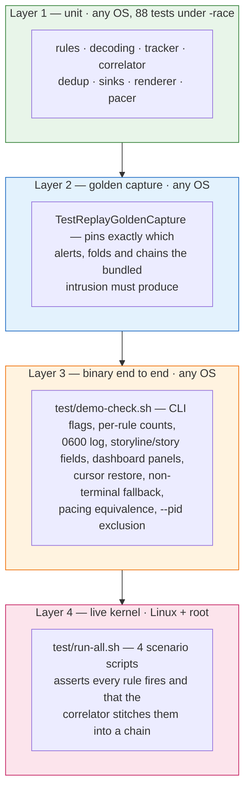

### 12.1 Techniques that made this testable

- **Dependency injection for the one impure rule.** The setuid-exec check needs
  `stat`. Calling `os.Stat` directly would mean creating a real setuid file —
  which requires root — to test it. `Config.Stat` is a `StatFunc`, so the rule
  stays a pure function of its inputs and CI needs no privilege.
- **A drift test over the ABI.** A test parses `bpf/event.h` and fails if the C
  enum and the Go constants diverge. The kernel and user-space views of the wire
  format cannot silently disagree.
- **`bpf2go` derives the Go event type from the object's BTF**, so the struct
  layout is generated rather than hand-mirrored.
- **Race detector in CI.** `CGO_ENABLED=1 go test -race` — which is how the
  dashboard's goroutine split is validated.
- **Golden capture regeneration** (`make capture-fixture`) uses the real decoder,
  so the fixture cannot drift from the production path.

### 12.2 Continuous integration

GitHub Actions runs four jobs on every push and pull request:

| Job | What it does |
| --- | ------------ |
| **Build and test** | Installs the eBPF toolchain, generates the bindings, verifies `gofmt`, runs `go vet`, runs the unit tests, builds the binary, smoke-tests it, and verifies the emitted BPF object is a valid ELF **containing BTF** — without which there is no CO-RE |
| **Lint** | `golangci-lint` v2 with 13 linters, tuned rather than maximal: every one enabled has caught a real class of bug here or guards an invariant the project depends on |
| **Shellcheck** | `shellcheck --severity=warning` over every script in `test/` |
| **Dev container** | Builds the Linux dev image and runs the full `make all` inside it, which is what proves the documented macOS build path still works |

Release automation is GoReleaser-based (`.goreleaser.yaml`).

### 12.3 Pre-demo verification

`make verify` compiles, runs all unit tests under `-race`, then runs
`test/demo-check.sh`. It requires no eBPF toolchain, so it runs on the machine a
demonstration is actually given from:

```
  ✓ privilege-escalation     1 alert(s)
  ✓ sensitive-file-access    2 alert(s)
  ✓ process-injection        1 alert(s)
  ✓ reverse-shell            1 alert(s)
  ✓ attack-chain             2 alert(s)
  ✓ reverse shell confirms the socket fd
  ✓ alert log is mode 0600
  ✓ dashboard declines a non-terminal
  ✓ 26-row terminal gets a 23-line frame
  ✓ pacing does not change the alerts
  ✓ --pid excludes the unrelated cron job

── Demo check passed: CLI, replay, dashboard, pacing and scope all verified
```

---

## 13. Results

### 13.1 Functional results

| Objective | Result |
| --------- | ------ |
| O1 in-kernel observation | 15 syscall tracepoints, no per-event context switch, no tracee opt-out |
| O2 portable single binary | CO-RE; one static Go binary, runs on any 5.8+ kernel with BTF |
| O3 four ATT&CK-mapped detections | 4 rules spanning 13 techniques across 5 tactics |
| O4 sequence detection | Reverse-shell chain detected with socket-fd confirmation |
| O5 cross-process correlation | `attack-chain` raised on 3+ tactics in one session-bounded tree |
| O6 testable detection surface | 88 tests, no kernel/root; `detect/` at 94.8% coverage |
| O7 machine-readable output | JSONL, 0600, append-only, stable field names |
| O8 noise control | Dedup (18 hits → 7 alerts + 11 folds on the golden capture), scope flags, severity gate |
| O9 offline replay | Lossless capture format; `--replay` through the identical pipeline |
| O10 situational awareness | Opt-in live dashboard with totals, tactics, chains, drops |
| O11 stated limits | Limitations section enumerating evasions, gaps and caveats |

### 13.2 Code and test metrics

| Metric | Value |
| ------ | ----- |
| Go source (excluding tests and generated bindings) | 6 914 lines |
| Go test source | 3 251 lines |
| eBPF C and headers | 1 243 lines |
| Shell test harness | 1 027 lines |
| Automated tests | 88 |
| Test runtime (`-race`, all packages) | ≈ 3 s |
| Statement coverage — `detect/` (all detection logic) | **94.8%** |
| Statement coverage — `events/` | 86.4% |
| Statement coverage — `output/` | 75.9% |
| Statement coverage — whole module | 63.0% (includes `ebpfloader/`, which cannot execute off Linux, and `cmd/` wiring) |
| `golangci-lint` findings | 0 |
| `shellcheck --severity=warning` findings | 0 |
| Third-party Go dependencies | 2 (`cilium/ebpf`, `golang.org/x/sys`) |

### 13.3 Golden-capture detection results

Replaying `testdata/captures/intrusion.jsonl` (38 events, 33.7 s of captured
activity, one SSH session carrying a four-stage intrusion plus benign activity
and a noisy cron job):

| Rule | Alerts |
| ---- | ------ |
| `privilege-escalation` | 1 |
| `sensitive-file-access` | 2 |
| `process-injection` | 1 |
| `reverse-shell` | 1 |
| `attack-chain` | 2 |
| **Total emitted** | **7** (plus 11 duplicates folded) |

Behaviours the capture is designed to confirm:

- The intrusion's four alerts, spanning five tactics, produce **one** storyline
  and an `attack-chain` incident that re-raises when the fifth tactic appears.
- The cron job reading `/etc/shadow` repeatedly produces **one** tactic and
  **no** chain, however loud — volume alone cannot escalate.
- `--pid 4100` retains the intrusion and excludes the out-of-tree cron job.
- Pacing (`--replay-speed`) changes presentation only: the alerts are identical.

### 13.4 Live-kernel results

`sudo ./test/run-all.sh` on a Linux host with BTF runs four scenario scripts
against the real agent and asserts each rule fires, plus the correlator:

```
  25 alerts written to /tmp/krnlsentry-e2e-alerts.jsonl

  ✓ privilege-escalation     6 alert(s)
  ✓ sensitive-file-access    17 alert(s)
  ✓ process-injection        1 alert(s)
  ✓ reverse-shell            1 alert(s)
  ✓ attack-chain             2 alert(s)
```

It exits non-zero if any rule fails to fire, so it functions as a smoke test
rather than only a demonstration. The scenarios are safe by construction: the
privilege-escalation syscalls are *expected* to fail with `EPERM` (entry-point
tracing alerts on attempts), the ptrace demo only reads, and the reverse-shell
scenario binds and dials `127.0.0.1` exclusively.

### 13.5 What was not measured

No throughput or overhead benchmark under production load was performed, and no
such figure is claimed. What the system does provide is the instrumentation to
measure loss when it happens: a per-CPU kernel stats map counts submitted and
dropped events, the user-space queue counts its own drops, and both are surfaced
continuously on the dashboard and in the shutdown summary. Any run with a
non-zero drop count is reported as incomplete coverage rather than presented as
a clean result.

---

## 14. Limitations

Stated plainly, because a detection whose limits cannot be articulated is a
detection that cannot be relied on.

### 14.1 Known evasions

| Evasion | Mechanism | Correct fix |
| ------- | --------- | ----------- |
| `comm`-based debugger allowlist | The ptrace rule exempts `gdb`, `strace`, `lldb`; `comm` is the first 15 bytes of the executable name, so copying a payload to `/tmp/gdb` bypasses it | Verify binary identity: resolve `/proc/<pid>/exe` and check a signature or an IMA/EVM measurement |
| Unresolved path matching | `openat("/etc/shadow")` is caught; a symlink, bind mount, relative path after `chdir`, or reading the block device is not | Hook at the VFS or LSM layer, where the resolved inode is available |
| Raw `open()` | Only `openat()` is watched; modern glibc routes `open()` through it, but a static binary issuing raw `open()` is missed | Add the `open` tracepoint |
| TOCTOU on the SUID check | The executed path is `stat`ed after the `execve` is observed, so a binary replaced in between is reported as whatever it is now | Capture the inode/dev at exec time via CO-RE |
| Relative `execve` paths | Resolving one needs the process's `cwd`, and by then the exec has replaced the image; guessing would produce confidently wrong alerts | Read `cwd` in-kernel at entry |

An accepted trade-off: `id_rsa.pub` matches the private-key pattern. Excluding
`.pub` would also miss `id_rsa.old` and `id_rsa.bak`, which *do* contain key
material, so over-matching a public key is the better failure.

### 14.2 Coverage gaps

- **No container or namespace awareness** — the most significant gap. The kernel
  reports PIDs from the initial namespace, but syscall *arguments* (such as
  `ptrace`'s target PID) are in the *caller's* namespace, so an alert can carry
  `pid: 22100` (host view) beside `target_pid: 71` (container view). There is no
  cgroup or container id on events, so "which container did this come from?"
  cannot be answered. Fixing it means reading
  `task->nsproxy->pid_ns_for_children` and the cgroup id via CO-RE.
- **No eBPF-side filtering** — every matching syscall produces a 544-byte event
  even when `--pid` will discard it immediately. On a busy host `openat` alone
  can be hundreds of thousands of events per second. This is the direct cost of
  decision D3 and is deliberately deferred to keep collection policy-free.
- **`capset()` is not diffed** — any `capset()` from a non-root process alerts.
  Deciding whether it actually *raises* privilege requires comparing the
  requested set against the process's bounding set (`task->cred->cap_bset`),
  otherwise a process legitimately *dropping* capabilities is indistinguishable
  from one raising them.
- **IPv6 destinations record family and port but not the address** — there is no
  room for a 16-byte address in the fixed-size event.
- **No `sched_process_fork` probe** — `--pid` descendant tracking learns of new
  children from their first syscall's PPID, so a grandchild whose parent exited
  before it was seen is re-parented to init and lost.
- **Strings are truncated** — paths at 256 bytes, argv at 3 entries × 64 bytes.

### 14.3 Correlator caveats

- **Session boundaries are `comm`-based**, so a process that names itself `sshd`
  splits its own storyline. That costs correlation, not detection: every
  underlying alert still fires.
- **PIDs are reused.** Lineage and storylines are keyed by PID within the chain
  window; on a host that wraps its PID space inside ten minutes an unrelated
  process could inherit a storyline. Exact fork/exit tracking closes this.
- **Replay checks setuid bits on the replaying host**, because the rule `stat`s
  the executed path — which under `--replay` is the local filesystem, not the
  captured one.

### 14.4 Scope limitations

Single host only; observation only (no blocking or response); no file-integrity
or network-payload inspection. The dashboard requires a terminal and is
guaranteed to fit from 24 rows upward.

---

## 15. Future work

In priority order, with the rationale for the ordering:

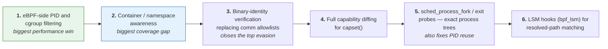

1. **eBPF-side PID and cgroup filtering.** Moving the scope filter into a BPF
   map consulted inside each probe removes the dominant cost of the policy-free
   collection design, and it is a map lookup rather than a verifier argument.
2. **Container and namespace awareness.** Without it, alerts from containerised
   workloads mix namespaces in a single record; with it, every alert can be
   attributed to a container.
3. **Binary-identity verification.** Closes the most exploitable evasion
   (§14.1) and generalises to other `comm`-based decisions, including session
   boundaries.
4. **Capability diffing for `capset()`.** Removes a whole class of false
   positive from processes correctly dropping privilege.
5. **`sched_process_fork`/`exit` probes.** Exact process-tree tracking, which
   also removes the PID-reuse caveat from the correlator.
6. **LSM hooks (`bpf_lsm`).** Resolved-path matching, closing the symlink and
   bind-mount evasions properly rather than by adding more path patterns.

Beyond the roadmap: a second correlation dimension (user and session rather than
only process tree), export to OpenTelemetry or a SIEM-native format, and a
signed-rule-pack mechanism so detections can be updated without redeploying the
agent.

---

## 16. Conclusion

KrnlSentry demonstrates that the hard part of host-based detection is not
collecting syscalls but *interpreting* them, and that the two are best kept
strictly apart. Putting observation in the kernel (eBPF, CO-RE, a globally
ordered ring buffer) and every judgement in user space (pure Go functions over a
plain struct) produced three results that justify the split:

1. **A sequence attack is detectable with confidence.** The reverse-shell rule
   fires on ordering within one process and confirms that the duplicated file
   descriptor is the socket's — a claim that needs the global ordering the ring
   buffer provides and the return value a `sys_exit` probe captures.
2. **Alerts become incidents.** Rebuilding process lineage from the whole event
   stream, bounding it at the session owner, and escalating on ATT&CK tactic
   breadth turns four rule hits across four PIDs into one CRITICAL story with a
   timeline — while leaving a loud single-tactic cron job correctly unescalated.
3. **The detection surface is verifiable on a laptop.** 88 tests, 94.8%
   statement coverage of `detect/`, a golden capture pinning exact outputs, and a
   replay path that reproduces live behaviour bit for bit without a kernel or
   root.

The project is deliberately explicit about what it does not catch, and its
roadmap is ordered by that honesty rather than by novelty: in-kernel filtering
first because it is the stated cost of the architecture, container awareness
second because it is the largest gap, binary identity third because it is the
most exploitable evasion. A detection tool whose limits are documented is one an
operator can actually reason about — which is, in the end, the property that
decides whether a security control is useful or merely present.

---

## 17. References

1. **MITRE ATT&CK** — Enterprise Matrix for Linux. https://attack.mitre.org/
   (techniques T1003, T1003.007, T1003.008, T1055, T1055.008, T1059, T1068,
   T1071, T1548, T1548.001, T1552, T1552.001, T1552.004)
2. **MITRE ATT&CK Tactics** — TA0002 Execution, TA0004 Privilege Escalation,
   TA0005 Defense Evasion, TA0006 Credential Access, TA0011 Command and Control.
3. **libbpf and BPF CO-RE** — "BPF Portability and CO-RE", Andrii Nakryiko.
   https://nakryiko.com/posts/bpf-portability-and-co-re/
4. **BPF ring buffer** — "BPF ring buffer", Andrii Nakryiko.
   https://nakryiko.com/posts/bpf-ringbuf/
5. **Linux kernel documentation** — BPF documentation, syscall tracepoints, and
   BTF. https://docs.kernel.org/bpf/
6. **cilium/ebpf** — pure-Go eBPF library and `bpf2go`.
   https://github.com/cilium/ebpf
7. **Linux man pages** — `ptrace(2)`, `openat(2)`, `setuid(2)`, `setresuid(2)`,
   `capset(2)`, `dup2(2)`, `socket(2)`, `connect(2)`, `execve(2)`,
   `capabilities(7)`, `proc(5)`.
8. **Keep a Changelog** (1.1.0) and **Semantic Versioning** (2.0.0) — the
   project's release documentation conventions.

---

## Appendix A — Repository layout

```
KrnlSentry/
├── bpf/
│   ├── krnlsentry.bpf.c        # eBPF programs: 15 syscall tracepoints
│   ├── event.h                 # shared event struct (544 B, 8-byte aligned)
│   └── vmlinux_min.h           # hand-written minimal CO-RE header
├── ebpfloader/                 # load, attach, drain; only user of cilium/ebpf
│   ├── loader.go               #   Linux implementation
│   ├── loader_other.go         #   stub off Linux, so replay builds anywhere
│   ├── decode.go  stats.go
├── events/                     # canonical Event, decoding, capture records
│   ├── event.go  syscall.go  constants.go  record.go
├── detect/                     # ALL detection logic — stdlib + events only
│   ├── engine.go               #   rule registry and evaluation order
│   ├── alert.go                #   Alert, Severity, ATT&CK techniques
│   ├── tracker.go              #   bounded per-PID history
│   ├── privesc.go  sensitivefile.go  ptrace.go  revshell.go
│   ├── storyline.go            #   lineage, storylines, tactics, attack-chain
│   └── dedup.go                #   fold identical findings per window
├── output/                     # sinks
│   ├── sink.go  jsonl.go  console.go
│   ├── dashboard.go            #   full-screen live display (--dashboard)
│   └── term.go term_unix.go term_other.go
├── cmd/krnlsentry/             # wiring only: flags, signals, pipeline, pacer
│   ├── main.go  pidfilter.go
├── internal/gencapture/        # golden-capture generator, on the real decoder
├── testdata/captures/          # intrusion.jsonl — golden capture
├── test/                       # 4 scenario scripts + runners
│   ├── run-all.sh              #   live end-to-end smoke test (Linux, root)
│   └── demo-check.sh           #   binary-level checks (any OS, no root)
├── docs/  README.md  DEMO.md  REPORT.md  CHANGELOG.md
├── Makefile  Dockerfile  .golangci.yml  .github/workflows/
```

## Appendix B — Command reference

```bash
# ── Build ───────────────────────────────────────────────────────────────
make docker-build && make docker-make TARGET=all   # macOS/Windows: container
make build                                          # Linux: native
make generate                                       # eBPF → Go bindings only

# ── Verify ──────────────────────────────────────────────────────────────
make verify           # compile + 88 tests under -race + demo-check.sh
make test             # unit tests
make cover            # coverage profile and summary
make lint vet fmt     # golangci-lint, go vet, gofmt
sudo ./test/run-all.sh  # live end-to-end (Linux, root, throwaway host)

# ── Demonstrate ─────────────────────────────────────────────────────────
make demo             # paced intrusion replay on the live dashboard
make demo SPEED=1     # real time (34 s)
make demo-live        # live kernel on the dashboard (Linux, root)
make replay-demo      # unpaced replay, scrolling output

# ── Run ─────────────────────────────────────────────────────────────────
sudo ./bin/krnlsentry                                 # system-wide
sudo ./bin/krnlsentry --dashboard                     # live display
sudo ./bin/krnlsentry --pid 1234                      # one process tree
sudo ./bin/krnlsentry --rules reverse-shell           # one rule
sudo ./bin/krnlsentry --min-severity HIGH --output /var/log/krnlsentry.jsonl
sudo ./bin/krnlsentry --verbose --debug-output capture.jsonl   # record
./bin/krnlsentry --replay capture.jsonl --output replayed.jsonl  # any OS
./bin/krnlsentry --list-rules
```

| Flag | Default | Description |
| ---- | ------- | ----------- |
| `--pid <int>` | `0` (all) | Monitor only this PID and its descendants |
| `--output <path>` | `./alerts.jsonl` | JSONL alert log |
| `--rules <list>` | all | Comma-separated subset of rules |
| `--verbose` | off | Log every observed syscall to a debug capture |
| `--debug-output <path>` | `./debug.jsonl` | Where `--verbose` writes |
| `--min-severity <level>` | `LOW` | Console/feed threshold; JSONL always gets everything |
| `--window <duration>` | `2s` | Reverse-shell chain window |
| `--dedup-window <duration>` | `5s` | Fold identical alerts (`0` disables) |
| `--no-storyline` | off | Disable correlation and `attack-chain` |
| `--chain-threshold <int>` | `3` | Distinct tactics in one tree that raise a chain |
| `--chain-window <duration>` | `10m` | How long a storyline stays open |
| `--dashboard` | off | Full-screen live display (needs a terminal) |
| `--replay <path>` | | Evaluate a capture instead of the live kernel |
| `--replay-speed <float>` | `0` | Pace a replay: `1` = real time, `0` = as fast as possible |
| `--ignore-loopback` | off | Suppress reverse-shell alerts to `127.0.0.0/8` |
| `--ignore-self-proc` | off | Suppress alerts for a process reading its own `/proc` |
| `--stats-interval <duration>` | off | Periodic throughput logging |
| `--no-color` / `--color` | auto | Override terminal detection (`NO_COLOR` honoured) |
| `--list-rules` / `--version` | | Print and exit |
